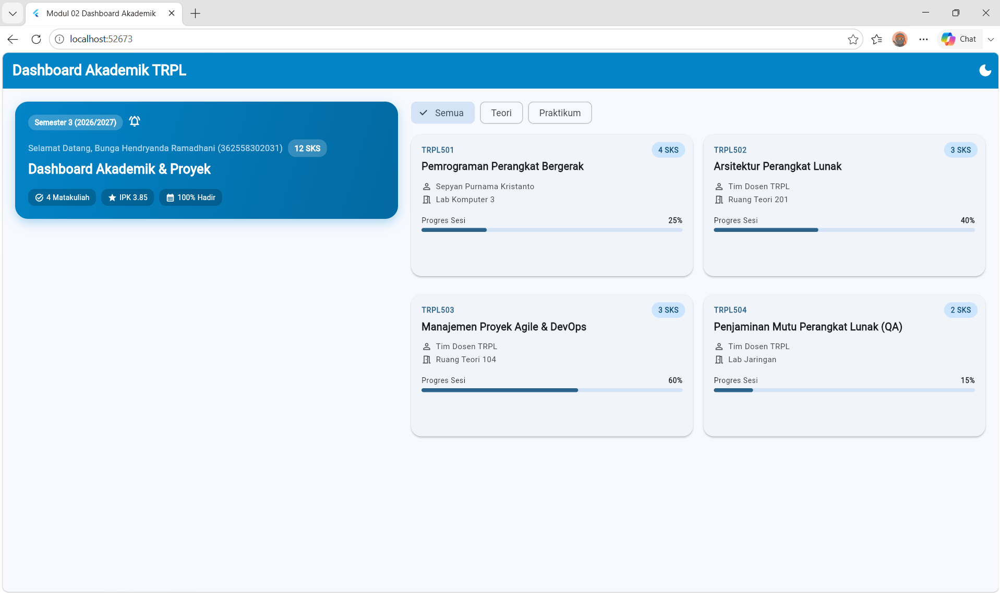
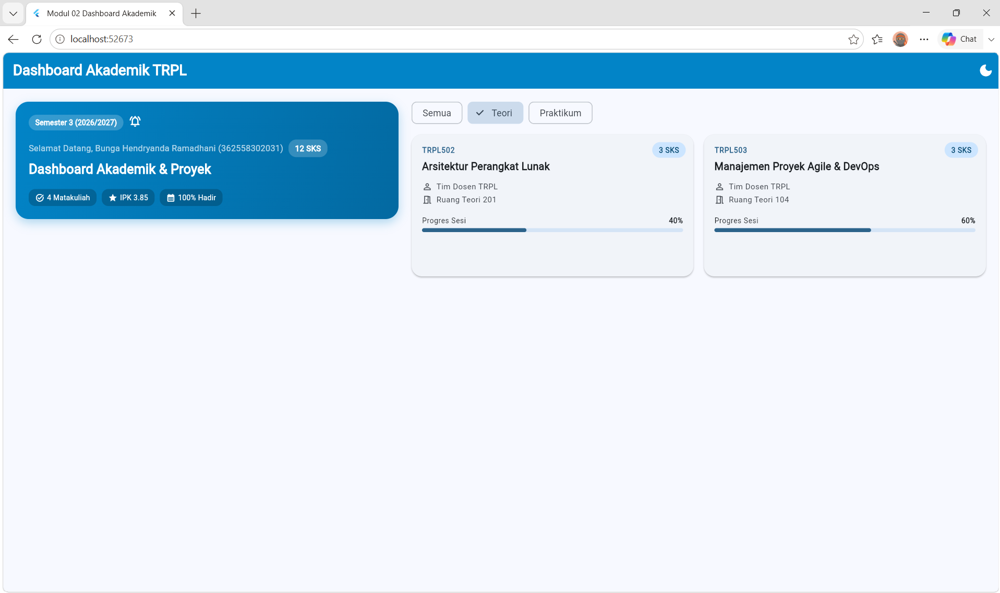
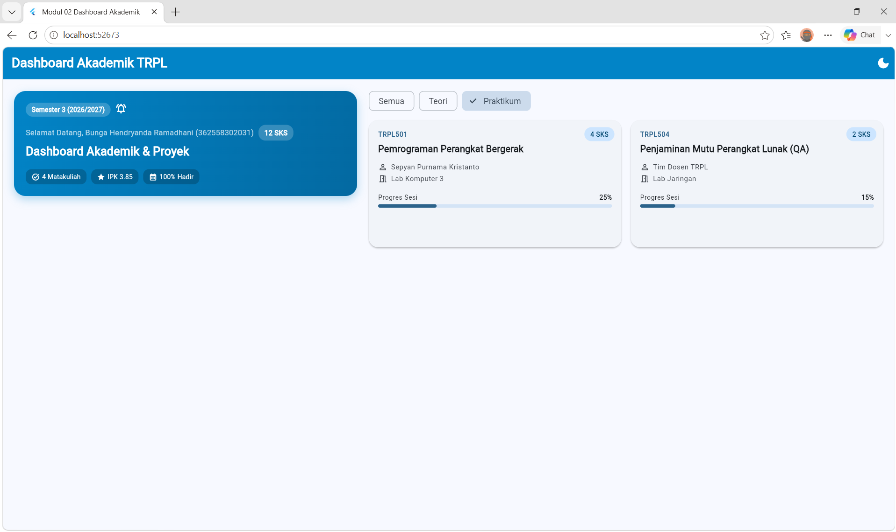
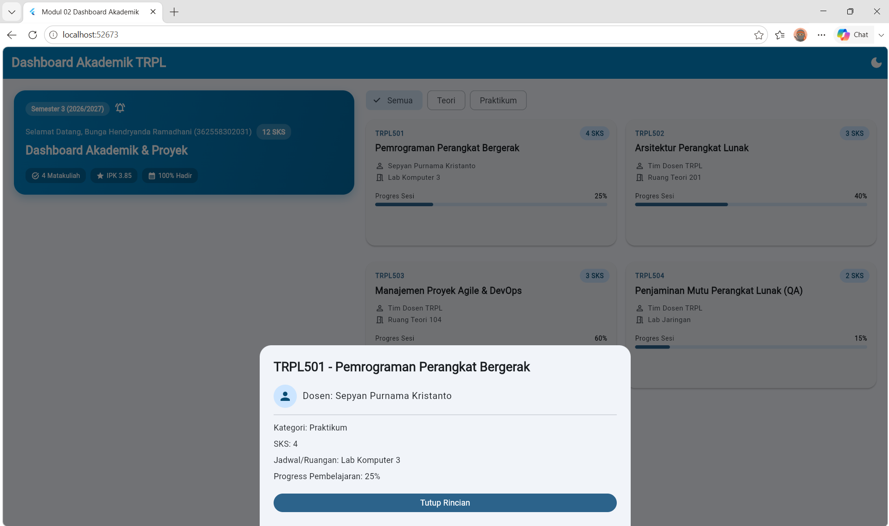
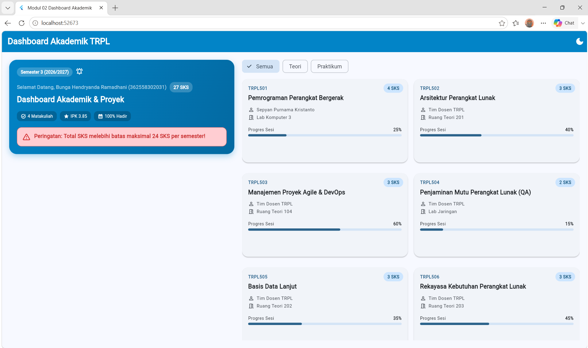
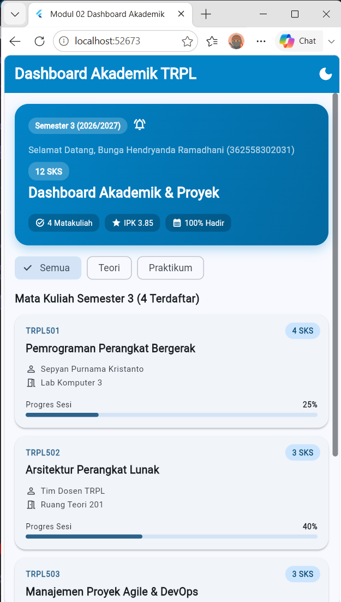
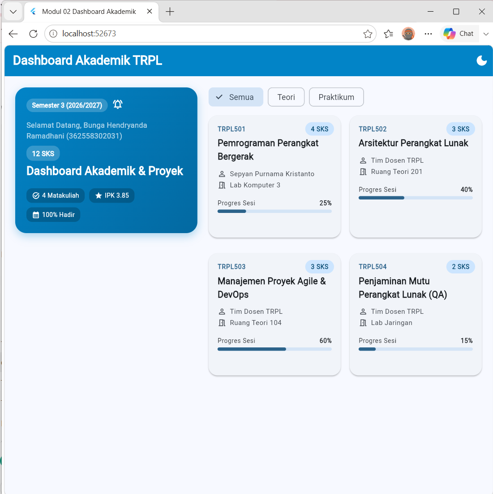
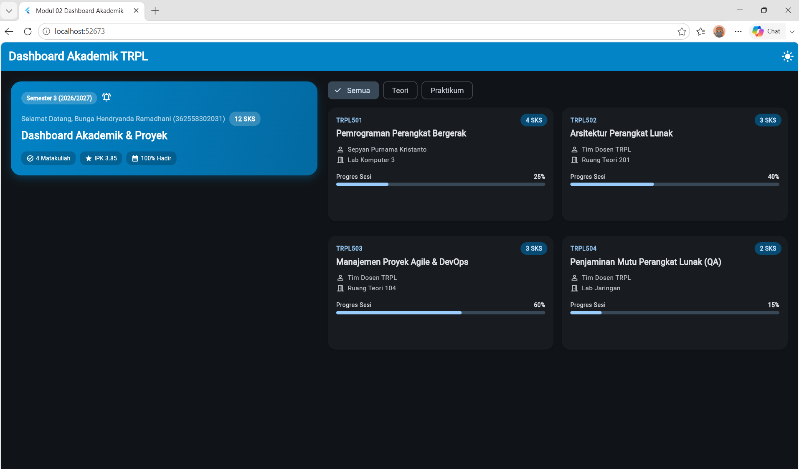

# Laporan Praktikum Modul 02: Declarative UI & Responsive Layout

- **Nama**: Bunga Hendryanda Ramadhani
- **NIM**: 362558302031
- **Kelas / Prodi**: 2CTRPL / Sarjana Terapan TRPL
- **Mata Kuliah**: Pemrograman Perangkat Bergerak
- **Semester**: 3

---

## 1. Ringkasan Implementasi

Pada Modul 02 saya membuat **Dashboard Akademik TRPL** menggunakan Flutter.

Pada modul ini saya menerapkan beberapa fitur, yaitu:

- `LayoutBuilder` untuk mengatur tampilan sesuai ukuran layar.
- Tampilan 1 kolom untuk layar kecil.
- Tampilan 2 kolom untuk layar yang lebih lebar.
- Filter mata kuliah menggunakan `Wrap` dan `ChoiceChip`.
- Kartu mata kuliah bisa diklik menggunakan `InkWell`.
- Detail mata kuliah ditampilkan menggunakan `showModalBottomSheet`.
- Total SKS dihitung menggunakan `fold()`.
- Peringatan muncul jika total SKS lebih dari 24 SKS.
- Tersedia Light Mode dan Dark Mode menggunakan Material 3.

---

## 2. Bukti Tangkapan Layar

### 2.1 Filter Kategori Mata Kuliah

Pada bagian ini saya menguji filter **Semua, Teori, dan Praktikum**.

| Semua | Teori | Praktikum |
|---|---|---|
|  |  |  |

Saat memilih kategori, daftar mata kuliah yang tampil ikut berubah sesuai kategori yang dipilih.

---

### 2.2 Detail Mata Kuliah dengan Bottom Sheet

Saya menguji tombol klik pada kartu mata kuliah. Setelah kartu ditekan, muncul rincian mata kuliah dari bagian bawah layar.

Rincian yang ditampilkan yaitu kode dan nama mata kuliah, dosen, kategori, jumlah SKS, ruangan, progress pembelajaran, dan tombol **Tutup Rincian**.

---

### 2.3 Peringatan Total SKS

Untuk menguji peringatan SKS, saya menambahkan beberapa mata kuliah sementara sampai jumlah SKS lebih dari 24 SKS.

Setelah peringatan berhasil muncul, data tambahan tersebut saya hapus kembali sehingga total mata kuliah kembali menjadi 12 SKS.

---

### 2.4 Tampilan Responsive

Saya menguji tampilan pada dua kondisi ukuran layar.

| 1 Kolom | 2 Kolom |
|---|---|
|  |  |

Pada lebar layar kurang dari 600dp, mata kuliah ditampilkan dalam satu kolom.

Pada lebar layar 600dp atau lebih, mata kuliah ditampilkan dalam dua kolom.

---

### 2.5 Light Mode dan Dark Mode

Saya juga mencoba tombol tema pada AppBar untuk mengubah tampilan dari Light Mode ke Dark Mode. Hasilnya teks dan komponen tetap bisa dibaca dengan baik.

---

## 3. Kendala Layout yang Dihadapi & Solusinya

### Kendala

Saat membuat tampilan responsive, jumlah kolom harus menyesuaikan dengan ukuran layar. Selain itu, isi kartu mata kuliah juga harus tetap rapi ketika ukuran layar berubah.

### Solusi

Saya menggunakan `LayoutBuilder` untuk membaca lebar layar.

- Jika lebar layar kurang dari 600dp, digunakan `ListView` dengan 1 kolom.
- Jika lebar layar 600dp atau lebih, digunakan `GridView` dengan 2 kolom.
- Pada teks yang terlalu panjang digunakan `maxLines` dan `TextOverflow.ellipsis`.
- Jarak antar komponen diatur menggunakan `SizedBox` agar tampilan tetap rapi.

---

## 4. Jawaban Pertanyaan Refleksi

### 1. Mengapa "Constraints go down, Sizes go up, Parent sets position" membuat layout Flutter efisien?

Menurut saya, aturan ini membuat proses layout Flutter lebih cepat karena setiap widget hanya perlu mengikuti alur yang jelas. Parent memberikan batas ukuran (constraints) ke child, lalu child menentukan ukuran yang sesuai dan hasil ukurannya dikembalikan ke parent. Setelah itu parent yang menentukan posisi child.

Karena prosesnya berjalan satu arah dan setiap widget diproses sekali, Flutter tidak perlu terus menghitung ulang layout yang sama. Hal ini membuat proses rendering bisa berjalan secara efisien dengan kompleksitas sekitar `O(N)` atau single-pass, dengan `N` adalah jumlah widget yang diproses.

### 2. Kapan widget sebaiknya dipecah menjadi file terpisah?

Menurut saya, widget sebaiknya dibuat menjadi file terpisah kalau widget tersebut cukup besar, punya fungsi yang jelas, atau kemungkinan akan digunakan lagi di bagian lain aplikasi.

Contohnya pada Modul 02 saya menggunakan `CourseCard` dalam file terpisah karena kartu mata kuliah memiliki tampilan dan fungsi sendiri, termasuk menampilkan detail saat diklik.

Sedangkan kalau widget-nya kecil dan hanya digunakan untuk satu bagian dari satu file, cukup dibuat sebagai private widget di file yang sama. Contohnya widget `_StatPill` pada `header_banner.dart` yang hanya digunakan untuk menampilkan informasi singkat di bagian header.

### 3. Bagaimana ThemeData M3 mempermudah pemeliharaan aplikasi?

Penggunaan `ThemeData` dan Material 3 membuat warna dan tampilan aplikasi bisa diatur dari satu tema. Jadi kita tidak perlu menentukan warna secara manual di setiap widget.

Misalnya saat ingin mengganti warna utama aplikasi atau membuat Dark Mode, cukup mengubah bagian tema sehingga komponen yang menggunakan `ColorScheme` bisa mengikuti perubahan tersebut. Menurut saya cara ini lebih rapi dan lebih mudah dipelihara, terutama kalau jumlah halaman dan widget dalam aplikasi sudah banyak.

---

## 5. Penggunaan AI

Dalam pengerjaan Modul 02 saya menggunakan ChatGPT sebagai bantuan untuk memahami
materi dan membantu memperbaiki kode.

| File | Penggunaan AI | Validasi yang Dilakukan |
|---|---|---|
| `academic_dashboard_screen.dart` | Membantu menerapkan filter kategori, `LayoutBuilder`, dan responsive layout | Dijalankan dengan `flutter analyze`, `flutter test`, dan dicoba langsung pada browser |
| `course_card.dart` | Membantu menambahkan `InkWell` dan `showModalBottomSheet` agar kartu bisa diklik | Dicoba dengan menekan kartu mata kuliah dan melihat detail yang muncul |
| `header_banner.dart` | Membantu menambahkan total SKS dan peringatan jika SKS lebih dari 24 | Diuji dengan menambahkan data sementara sampai total SKS melebihi 24 |
| `course.dart` | Membantu menambahkan kategori `Teori` dan `Praktikum` pada data mata kuliah | Dicoba menggunakan filter `Semua`, `Teori`, dan `Praktikum` |

