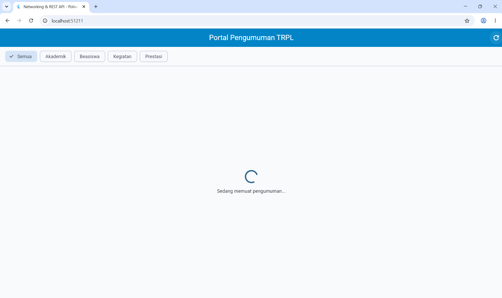
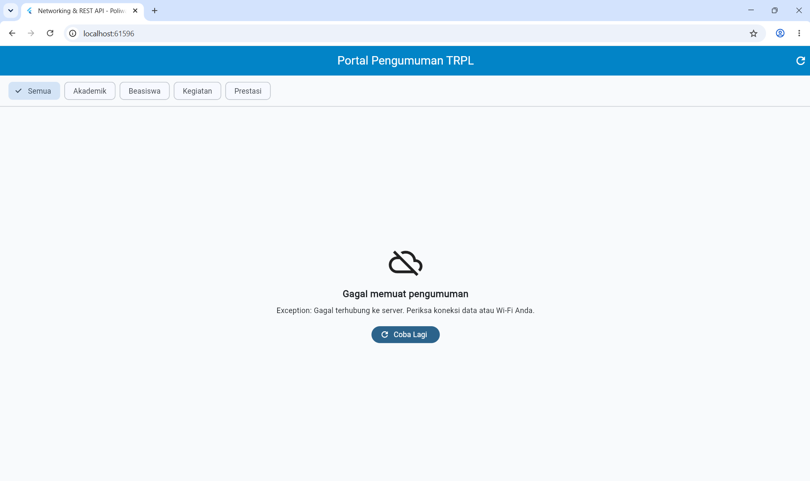
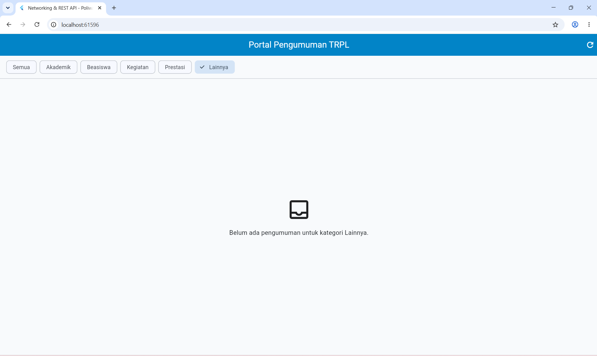
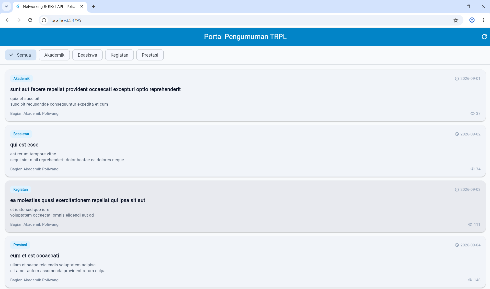

# Modul 04 — Networking & REST API

| **Informasi**        | **Data Mahasiswa** |
| -------------------- | ------------------ |
| **Nama Lengkap**     | Bunga Hendryanda Ramadhani |
| **NIM**              | 362558302031 |
| **Kelas / Angkatan** | TRPL 2C / 2025 |
| **Dosen Pengampu**   | Sepyan Purnama Kristanto, M.Kom. |

---

## 1. Tujuan Praktikum

Pada Modul 04 saya mempelajari cara aplikasi Flutter melakukan komunikasi
dengan REST API melalui HTTP. Pada Fase A saya membuat aplikasi Portal
Pengumuman yang mengambil data dari server, menampilkan daftar pengumuman,
melakukan filter kategori, membuka detail, dan menangani beberapa keadaan
seperti loading, error, kosong, dan berhasil.

Pada Fase B saya mempelajari pengembangan aplikasi menggunakan Dio,
Repository Pattern, dan Riverpod agar pengambilan data dan pengelolaan state
lebih terpisah dari tampilan.

---

## 2. Struktur Folder

```text
04-week-4/
├── lib/
│   ├── main.dart
│   │
│   ├── modul_04/
│   │   ├── modul_04_app.dart
│   │   ├── models/
│   │   │   └── announcement.dart
│   │   ├── services/
│   │   │   └── announcement_api.dart
│   │   ├── widgets/
│   │   │   └── announcement_card.dart
│   │   └── screens/
│   │       ├── announcement_list_screen.dart
│   │       └── announcement_detail_screen.dart
│   │
│   └── pengayaan/
│       └── modul_04/
│           ├── modul_04_pengayaan_main.dart
│           ├── modul_04_pengayaan_app.dart
│           ├── datasources/
│           │   └── announcement_remote_datasource.dart
│           ├── repositories/
│           │   ├── announcement_repository.dart
│           │   ├── announcement_repository_impl.dart
│           │   └── sample_announcement_repository.dart
│           ├── providers/
│           │   └── announcement_provider.dart
│           └── screens/
│               └── announcement_list_screen.dart
│
├── screenshots/
│   ├── announcement_loading.png
│   ├── announcement_error.png
│   ├── announcement_empty.png
│   └── announcement_success.png
│
├── test/
│   └── modul_04_test.dart
│
├── pubspec.yaml
└── README.md
```

Folder `modul_04` digunakan untuk Fase A, sedangkan folder
`pengayaan/modul_04` digunakan untuk Fase B.

File `main.dart` menjalankan aplikasi Fase A.

---

## 3. Fase A — Portal Pengumuman

Fase A menggunakan package `http` untuk mengambil data dari REST API.

Endpoint yang digunakan:

```text
https://jsonplaceholder.typicode.com/posts?_limit=10
```

Data dari JSONPlaceholder kemudian diubah menjadi model `Announcement`
agar dapat digunakan oleh aplikasi.

Fase A menggunakan:

- `http`
- `FutureBuilder`
- `StatefulWidget`
- `Navigator.push()`
- `Navigator.pop()`
- `RefreshIndicator`
- filter kategori

Fase A tidak menggunakan Dio, Repository Pattern, maupun Riverpod.

### 3.1 Pengambilan Data

`AnnouncementApi` bertugas melakukan request GET ke server dan mengubah
JSON response menjadi daftar `Announcement`.

Aplikasi juga menyediakan mode simulasi untuk membuktikan keadaan loading:

```bash
flutter run --dart-define=SIMULASI=true
```

Pada mode tersebut data tidak diambil dari internet dan sengaja diberi
jeda selama satu detik.

### 3.2 Empat Keadaan Aplikasi

Fase A memiliki empat keadaan utama:

```text
Loading → Error
       ↘
        Empty / Success
```

Keadaan loading muncul ketika Future masih berjalan.

Keadaan error muncul ketika request gagal atau server memberikan response
yang tidak sesuai.

Keadaan empty muncul ketika data berhasil diperoleh tetapi tidak ada data
yang sesuai dengan kategori yang dipilih.

Keadaan success muncul ketika data berhasil diterima dan dapat ditampilkan.

### 3.3 Filter Kategori

Aplikasi menyediakan beberapa kategori:

```text
Semua
Akademik
Beasiswa
Kegiatan
Prestasi
```

Filter dilakukan terhadap data yang sudah diperoleh sehingga memilih kategori
tidak mengirim request baru ke server.

### 3.4 Detail Pengumuman

Ketika salah satu kartu pengumuman ditekan, aplikasi membuka halaman detail
menggunakan `Navigator.push()`.

Data pengumuman dikirim melalui constructor ke halaman detail.

Untuk kembali ke halaman daftar digunakan:

```dart
Navigator.pop(context);
```

### 3.5 Refresh

Aplikasi memiliki dua cara untuk memuat ulang data.

Pertama melalui tombol refresh pada `AppBar`.

Kedua menggunakan tarik layar ke bawah dengan `RefreshIndicator`.

Keduanya akan melakukan request baru ke server.

---

## 4. Bukti Screenshot

### 4.1 Keadaan Loading



Screenshot menunjukkan indikator loading dan teks:

```text
Sedang memuat pengumuman...
```

Keadaan ini digunakan untuk membuktikan bahwa aplikasi tidak langsung
menampilkan layar kosong ketika data masih dalam proses diambil.

### 4.2 Keadaan Error



Screenshot menunjukkan keadaan ketika request gagal. Aplikasi menampilkan
pesan error dan tombol:

```text
Coba Lagi
```

Tombol tersebut dapat digunakan untuk melakukan request kembali.

### 4.3 Keadaan Empty



Screenshot menunjukkan keadaan ketika kategori yang dipilih tidak memiliki
data pengumuman.

Aplikasi menampilkan ikon dan pesan yang menyebutkan kategori yang sedang
dipilih.

### 4.4 Keadaan Success



Screenshot menunjukkan daftar pengumuman yang berhasil diambil dari REST
API.

Pada tampilan ini terdapat:

- judul aplikasi
- tombol refresh
- filter kategori
- kartu pengumuman
- kategori
- tanggal
- judul
- isi pengumuman
- penulis
- jumlah pembaca

---

## 5. Fase B — Pengayaan

Pada Fase B, aplikasi dikembangkan menggunakan beberapa library tambahan,
yaitu Dio dan Riverpod.

Struktur aplikasi menjadi lebih terpisah:

```text
UI
 ↓
Riverpod
 ↓
Repository
 ↓
Remote DataSource
 ↓
Dio
 ↓
REST API
```

### 5.1 Dio

Dio digunakan untuk menggantikan package `http` pada pengambilan data.

Konfigurasi seperti:

- `baseUrl`
- `connectTimeout`
- `receiveTimeout`
- header
- interceptor

diletakkan pada `RemoteDataSource`.

### 5.2 Repository Pattern

Repository digunakan sebagai perantara antara UI dengan sumber data.

Kontrak repository dibuat pada:

```text
announcement_repository.dart
```

Kemudian implementasinya dibuat pada:

```text
announcement_repository_impl.dart
```

Dengan cara ini UI tidak perlu mengetahui apakah data berasal dari server
atau dari sumber data lokal.

### 5.3 Sample Repository

Selain sumber data dari server, Fase B juga memiliki:

```text
SampleAnnouncementRepository
```

Repository tersebut menggunakan data sample sehingga aplikasi dapat
dijalankan tanpa koneksi internet.

Data sample disalin menggunakan:

```dart
List<Announcement>.of(...)
```

agar list dapat dimodifikasi dan tidak menimbulkan error ketika dilakukan
operasi seperti `add()`.

### 5.4 Riverpod

Riverpod digunakan untuk mengelola state kategori dan data pengumuman.

Kategori yang dipilih disimpan pada:

```text
selectedCategoryProvider
```

Sedangkan data pengumuman dikelola oleh:

```text
announcementsProvider
```

Saat kategori berubah, provider pengumuman akan menghitung ulang data secara
otomatis.

### 5.5 Pergantian Sumber Data

Fase B dapat dijalankan menggunakan data sample:

```bash
flutter run -t lib/pengayaan/modul_04/modul_04_pengayaan_main.dart --dart-define=USE_SAMPLE_DATA=true
```

atau menggunakan server:

```bash
flutter run -t lib/pengayaan/modul_04/modul_04_pengayaan_main.dart
```

Pergantian sumber data tersebut tidak memerlukan perubahan pada screen.

---

## 6. Perbedaan Fase A dan Fase B

| Bagian | Fase A | Fase B |
|---|---|---|
| HTTP Client | `http` | `Dio` |
| Pengambilan data | `AnnouncementApi` | `RemoteDataSource` |
| Arsitektur | Sederhana | Repository Pattern |
| State | `StatefulWidget` | Riverpod |
| Async State | `FutureBuilder` | `AsyncValue` |
| Filter | Di dalam screen | Di dalam repository |
| Sumber data | Server dan mode simulasi | Server dan sample repository |
| Provider | Tidak digunakan | `flutter_riverpod` |

Pada Fase A, struktur program masih sederhana sehingga lebih mudah
dipahami. Screen langsung menggunakan `AnnouncementApi` dan mengatur state
menggunakan `StatefulWidget`.

Pada Fase B, tanggung jawab program dipisahkan menjadi beberapa bagian.
Dio menangani komunikasi jaringan, datasource menangani sumber data,
repository menjadi penghubung antara sumber data dan aplikasi, sedangkan
Riverpod menangani state.

Fase B mempunyai kode yang lebih banyak, tetapi struktur aplikasinya lebih
terpisah dan lebih mudah dikembangkan.

---

## 7. Refleksi

### 7.1 Filter pada Fase A dan Fase B

Pada Fase A, filter kategori dilakukan di dalam `build()` menggunakan
`where()`. Menurut saya cara ini lebih mudah dipahami karena proses filter
langsung terlihat di screen.

Pada Fase B, filter dipindahkan ke repository. Hal ini membuat kode pada
screen menjadi lebih sederhana karena screen hanya menerima data yang akan
ditampilkan. Kekurangannya adalah struktur kode menjadi lebih banyak dan
saya harus memahami hubungan antara provider, repository, dan datasource.

### 7.2 Mengapa `catch (e) { return []; }` Tidak Baik?

Menurut saya, mengembalikan list kosong ketika terjadi error justru membuat
aplikasi lebih membingungkan. Pengguna akan mengira tidak ada data, padahal
sebenarnya request mengalami masalah.

Lebih baik error diteruskan ke UI agar aplikasi bisa menampilkan pesan yang
sesuai dan menyediakan tombol `Coba Lagi`.

### 7.3 List `const` pada Fase A dan Fase B

Pada Fase A, data sample hanya dikembalikan sehingga tidak ada operasi untuk
mengubah list tersebut.

Pada Fase B, `SampleAnnouncementRepository` menyimpan data sample ke dalam
list yang dapat berubah karena repository memiliki fungsi untuk menambah
pengumuman. Karena itu list dari data sample perlu disalin menggunakan
`List.of(...)`.

### 7.4 Retry Otomatis pada Riverpod 3

Menurut saya, retry otomatis berguna karena gangguan jaringan bisa saja
hanya sementara. Dengan retry, aplikasi dapat mencoba kembali tanpa harus
selalu menunggu pengguna menekan tombol.

Namun, retry otomatis dapat menjadi kurang cocok ketika sedang melakukan
pengujian error karena provider dapat mencoba ulang beberapa kali dan proses
pengujian menjadi lebih lama.

### 7.5 Endpoint Hanya Boleh Dipanggil Sekali per Hari

Menurut saya, `FutureBuilder` masih bisa digunakan selama Future disimpan di
dalam `State` dan request tidak dibuat ulang setiap kali `build()` berjalan.

Request baru cukup dilakukan ketika data memang perlu dimuat ulang. Dengan
cara tersebut jumlah request dapat dikontrol sehingga tidak melebihi kuota
yang diberikan server.

---

## 8. Penggunaan AI

Dalam pengerjaan Modul 04 saya menggunakan ChatGPT sebagai alat bantu untuk
memahami materi dan membantu proses pengerjaan kode.

AI digunakan untuk membantu memahami:

- request HTTP dan REST API
- package `http`
- `FutureBuilder`
- loading, error, empty, dan success state
- `RefreshIndicator`
- Dio
- Repository Pattern
- Riverpod

AI juga digunakan untuk membantu mencari penyebab error dan warning yang
muncul saat pengerjaan.