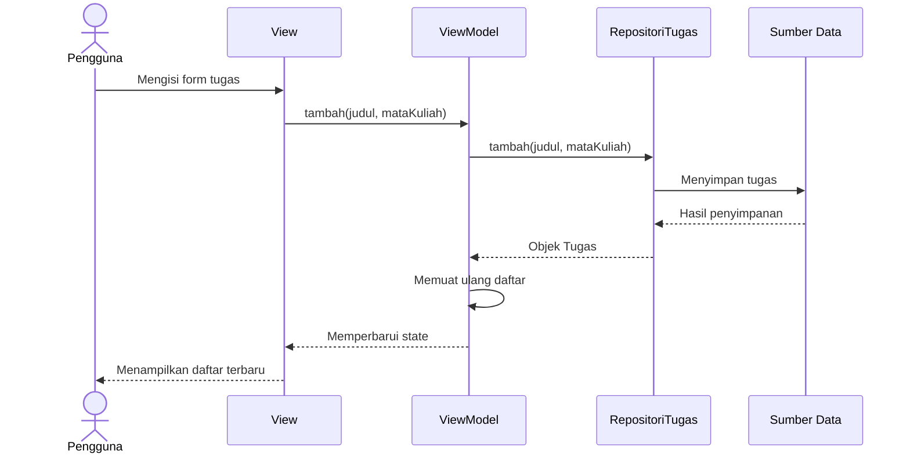

# Week 7 — Refactoring Fitur Tugas

## Identitas Mahasiswa

- **Nama:** Bunga Hendryanda Ramadhani
- **NIM:** 362558302031
- **Program Studi:** D4 Teknologi Rekayasa Perangkat Lunak
- **Kelas:** 2CTRPL
- **Mata Kuliah:** Pemrograman Perangkat Bergerak
- **Institusi:** Politeknik Negeri Banyuwangi

## 1. Deskripsi

Proyek ini merupakan implementasi materi Week 7 tentang pemisahan tanggung jawab pada aplikasi Flutter. Fitur yang digunakan adalah daftar tugas mahasiswa, mulai dari menampilkan daftar, menambah tugas, mengubah status selesai, sampai menghapus tugas.

Refactoring dilakukan dengan memisahkan entity, kontrak repository, implementasi data, ViewModel, dan tampilan. Terdapat juga pengayaan berupa repository berbasis SharedPreferences dan use case tambahan.

## 2. Tujuan

- Memisahkan logika tampilan, pengelolaan state, dan penyimpanan data.
- Menggunakan kontrak repository agar lapisan presentasi tidak bergantung langsung pada implementasi data.
- Menguji operasi utama dan jalur kegagalan.
- Memastikan aturan impor antarlapisan melalui pengujian arsitektur.
- Mencoba penyimpanan persisten menggunakan SharedPreferences.

## 3. Diagram Urutan Tambah Tugas

### Method dan nilai balik

| Komponen | Method atau proses | Hasil |
|---|---|---|
| View | Mengirim input form | Data judul dan mata kuliah |
| ViewModel | `tambah(...)` | `Future<bool>` yang menandakan aksi berhasil atau gagal |
| Repository | `tambah(...)` | `Future<Tugas>` |
| ViewModel | Memuat ulang daftar setelah berhasil | State daftar diperbarui |
| View | Mendengarkan perubahan state | Tampilan mengikuti state terbaru |

Pada implementasi pengayaan, ViewModel memanggil use case `TambahTugas.panggil(...)`. Use case mengembalikan `Hasil<Tugas>`, berupa `Sukses<Tugas>` atau `Gagal<Tugas>`. Setelah penambahan berhasil, ViewModel memuat ulang daftar agar tampilan menampilkan data terbaru.

## 4. Struktur dan Tanggung Jawab Komponen

| Komponen | Lokasi | Tanggung jawab |
|---|---|---|
| Entity | `lib/modul_07/domain/tugas.dart` | Menyimpan data tugas dan operasi penyalinan objek |
| Kontrak repository | `lib/modul_07/domain/repositori_tugas.dart` | Menentukan operasi yang harus disediakan repository |
| Kegagalan domain | `lib/modul_07/domain/kegagalan.dart` | Mendefinisikan jenis kegagalan |
| Sumber data memori | `lib/modul_07/data/sumber_tugas_memori.dart` | Menyediakan penyimpanan memori untuk implementasi dasar |
| Repository memori | `lib/modul_07/data/repositori_tugas_memori.dart` | Menjalankan operasi repository menggunakan sumber data memori |
| State daftar | `lib/modul_07/presentation/state_daftar_tugas.dart` | Merepresentasikan state daftar tugas |
| Pengayaan | `lib/pengayaan/modul_07/` | Menampung implementasi tambahan, use case, repository persisten, dan tampilan pengayaan |
| Pengujian | `test/` | Memeriksa operasi, kegagalan, persistensi, dan aturan arsitektur |

## 5. Composition Root dan Lifecycle

Composition root merupakan bagian yang membuat dan menghubungkan objek-objek aplikasi. Pada pengayaan, pengaturan dependensi terdapat di `lib/pengayaan/modul_07/modul_07_pengayaan_app.dart` dan `lib/pengayaan/modul_07/core/lokator.dart`.

Repository diberikan kepada use case, kemudian use case digunakan oleh ViewModel. Dengan cara ini, ViewModel tidak perlu membuat atau mengetahui detail implementasi penyimpanan secara langsung.

ViewModel pengayaan menggunakan `ChangeNotifier`. Ketika state berubah, ViewModel memberi tahu pendengar melalui `notifyListeners()`. Saat objek tidak lagi digunakan, `dispose()` dipanggil untuk menandai objek telah dibuang dan menjalankan proses pembersihan dari `ChangeNotifier`.

## 6. Perilaku Penyimpanan

### Fase A

Implementasi dasar menggunakan repository dan sumber data memori. Data berada di memori aplikasi sehingga tidak ditujukan untuk mempertahankan data setelah proses aplikasi berakhir.

### Fase B — Pengayaan

Pengayaan menyediakan `RepositoriTugasPrefs` dengan `SharedPreferencesAsync`. Data tugas disimpan menggunakan mekanisme penyimpanan key-value. Pengujian menggunakan fake platform untuk memeriksa operasi penambahan, pemuatan kembali, perubahan status, dan penghapusan.

Pengujian fake platform tidak menggantikan pengujian integrasi pada perangkat target. Integrasi plugin dan perilaku penyimpanan nyata tetap perlu diverifikasi sesuai platform yang digunakan.

## 7. Pengujian

Pengujian dijalankan melalui Flutter Test dan Flutter Analyze.

| Pengujian | Tujuan |
|---|---|
| `test/widget_test.dart` | Memastikan aplikasi menampilkan daftar tugas |
| `test/repositori_tugas_gagal_test.dart` | Memeriksa kegagalan pemuatan dan penambahan |
| `test/repositori_tugas_prefs_test.dart` | Memeriksa operasi repository SharedPreferences melalui fake platform |
| `test/architecture_test.dart` | Memastikan ViewModel tidak mengimpor lapisan data |
| `test/tandai_semua_selesai_test.dart` | Memeriksa pembaruan massal dan kegagalan parsial |

### Hasil pengujian terakhir

- `flutter test`: 8 pengujian lolos sebelum penambahan test `TandaiSemuaSelesai`.
- `flutter test test/tandai_semua_selesai_test.dart`: 2 pengujian lolos.
- `flutter analyze`: tidak ditemukan masalah.

Setelah penambahan use case, seluruh pengujian proyek dijalankan kembali dan menghasilkan 8 pengujian lolos. Hasil analyzer juga tetap bersih.

## 8. Use Case `TandaiSemuaSelesai`

Use case ini menerima daftar tugas, melewati tugas yang sudah selesai, lalu memperbarui status tugas yang belum selesai melalui kontrak repository.

Hasilnya memuat jumlah tugas yang berhasil diperbarui dan daftar kegagalan. Jika salah satu operasi gagal, proses tetap mencoba tugas berikutnya. Perubahan yang sudah berhasil tidak otomatis dibatalkan.

Kebijakan tersebut dipilih karena kontrak repository belum menyediakan transaksi atomik untuk beberapa perubahan sekaligus. Karena itu, hasil parsial harus dilaporkan dan tidak boleh dianggap sebagai keberhasilan penuh.

## 9. Pertanyaan Refleksi

### 1. Bagian mana yang berubah ketika implementasi penyimpanan diganti?

Bagian yang berubah adalah implementasi repository dan sumber data yang digunakan. Lapisan presentasi tetap berkomunikasi melalui kontrak `RepositoriTugas`. Dengan begitu, perubahan dari penyimpanan memori ke SharedPreferences tidak mengharuskan ViewModel mengetahui detail penyimpanan secara langsung.

### 2. Apa perbedaan state lokal form dan state daftar di ViewModel?

State lokal form digunakan untuk mengelola input sementara pengguna, misalnya judul dan mata kuliah. State daftar yang dikelola ViewModel digunakan untuk mengatur data yang ditampilkan, status pemuatan, serta pesan kegagalan. Keduanya memiliki tujuan yang berbeda.

### 3. Apa yang dibuktikan oleh fake repository, dan apa yang masih memerlukan pengujian integrasi?

Fake repository dapat digunakan untuk menguji logika aplikasi secara terkontrol tanpa bergantung pada penyimpanan asli. Pengujian integrasi tetap diperlukan untuk memastikan plugin penyimpanan bekerja dengan benar pada platform target.

### 4. Bagaimana membuktikan hasil baca tidak mengubah penyimpanan secara tidak sengaja?

Data dapat dibaca dari repository, kemudian objek atau daftar hasil baca diubah jika memungkinkan. Setelah itu, data dibaca kembali dari repository. Jika data yang tersimpan tidak berubah, hasil tersebut mendukung bahwa perubahan pada hasil baca tidak memengaruhi penyimpanan. Pengujian perlu disesuaikan dengan cara repository mengembalikan objek dan koleksi.

### 5. Apakah use case dan service locator diperlukan?

Use case membantu memisahkan aturan operasi dari ViewModel, sedangkan service locator memusatkan pengelolaan dependensi. Keduanya bermanfaat ketika aplikasi berkembang dan memiliki lebih banyak aturan bisnis atau implementasi. Namun, keduanya juga menambah jumlah file dan kompleksitas. Untuk fitur sederhana, pemakaiannya perlu disesuaikan dengan kebutuhan proyek.

## 10. Bukti Pengerjaan

Bukti aplikasi dan hasil pengujian disimpan pada direktori berikut:

- `evidence/screenshots/` — screenshot aplikasi Fase A dan Fase B.
- `evidence/output/flutter_analyze.txt` — keluaran analyzer.
- `evidence/output/flutter_test.txt` — keluaran pengujian proyek.
- `evidence/output/architecture_test.txt` — keluaran pengujian arsitektur.
- `evidence/output/repositori_tugas_gagal_test.txt` — keluaran pengujian kegagalan repository.
- `evidence/output/repositori_tugas_prefs_test.txt` — keluaran pengujian repository persisten.

## 11. Kesimpulan

Refactoring membantu memisahkan tanggung jawab sehingga tampilan, state, aturan operasi, dan penyimpanan lebih mudah diuji secara terpisah. Kontrak repository juga membuat implementasi data dapat diganti tanpa mengharuskan lapisan presentasi mengetahui detailnya.

Pengujian operasi utama, jalur kegagalan, persistensi melalui fake platform, dan aturan impor membantu memeriksa perilaku aplikasi. Pengembangan berikutnya dapat mencakup pengujian integrasi pada perangkat target dan integrasi use case `TandaiSemuaSelesai` ke ViewModel serta tampilan jika fitur tersebut ingin digunakan langsung oleh pengguna.
